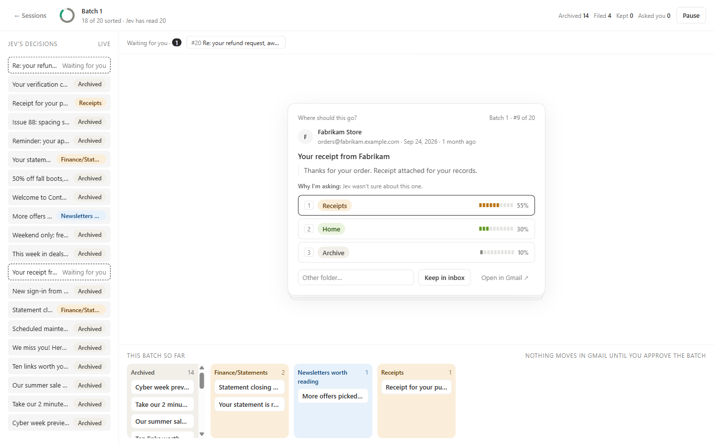
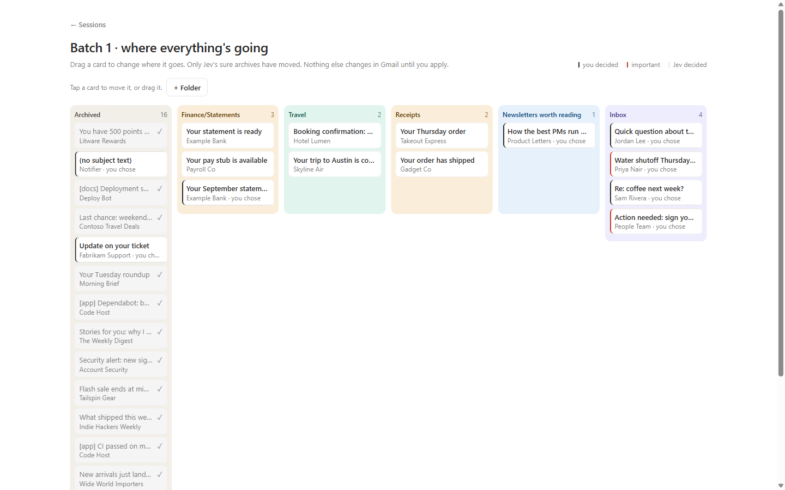
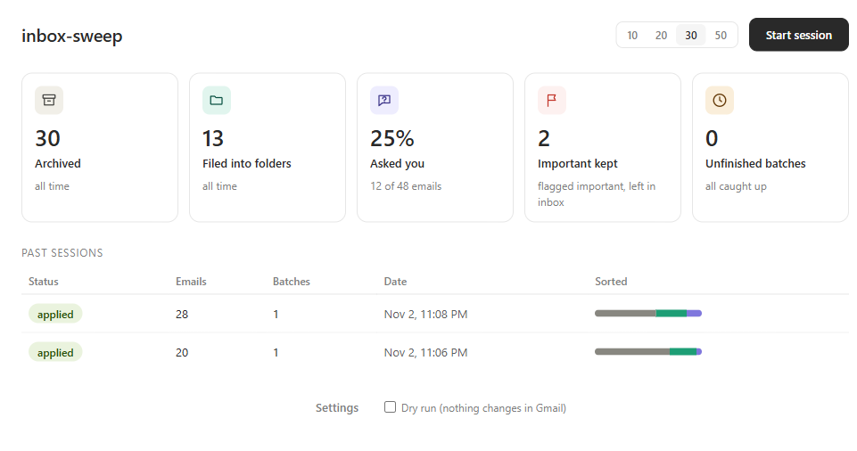

# inbox-sweep

Get your Gmail to inbox zero, and keep it there, a batch at a time.

inbox-sweep goes through your inbox 10 to 50 emails at a time, oldest first. A decision model ([Jev](https://typesafe.ai/) from TypeSafe) reads each email. Clear junk gets archived. Anything it isn't sure about becomes a quick card you answer with 1, 2 or 3. Nothing is filed into a folder until you approve it.

It runs on your own machine with your own accounts. Nothing is hosted.



## Try it in 1 minute (no accounts needed)

Fake mode uses a made-up inbox, so you can click around before connecting anything. You need Node 22.12 or newer.

```sh
git clone https://github.com/Meerav29/inbox-sweep.git
cd inbox-sweep
npm install
npm run dev:fake
```

Then open http://localhost:5173 and press **Start session**.

## Use it on your own inbox

Copy `.env.example` to `.env` (or run `npm run doctor -- --init-env` to do it) and add three sets of keys:

1. **Google:** a client ID and secret for your own OAuth client from the Google Cloud console. [Step-by-step](docs/details.md#google).
2. **TypeSafe:** an API key from [typesafe.ai](https://typesafe.ai/) so Jev can make the decisions.
3. **Anthropic (optional):** an API key so each card can say why it's asking. Claude Haiku writes that text, and cards still work without it.

Run `npm run doctor` to check each key and the Gmail connection. It prints the exact redirect URI to give Google.

Then run `npm run dev`, open http://localhost:5173, and the Setup screen has you connect Gmail and pick the folders it's allowed to file into.

Do your first run with **Dry run** ticked on Home. You'll see every decision without anything changing in Gmail.

## How it decides

- **Sure archives:** clear junk, or an old notice whose moment has passed (an expired code, a delivery that already arrived), is archived right away.
- **Review cards:** if Jev isn't sure, you get a card with its top three guesses and how confident it is in each.
- **Important mail:** anything that looks like it needs you goes to the front of the queue and stays in your inbox.
- **The board:** at the end of a batch you can drag anything to a different place, and folder moves only happen when you press **Apply**.



The Home screen keeps a running count of what's been archived, filed and asked.



## Safe by design

- It **never deletes** anything, and never marks anything as spam. The worst case is an archived email that's still in All Mail.
- Your API keys and Gmail token stay on your machine. The browser never sees them.
- Email bodies are never saved. Only details like the sender, subject and date are kept, in a local SQLite file under `data/`.
- Email content does go to TypeSafe (every email) and Anthropic (only the ones you're asked about). [What's sent where](docs/details.md#privacy).

## Make it yours

The rules live in [`server/policy/decide.ts`](server/policy/decide.ts), and the questions Jev is asked are in [`server/jev/questions.ts`](server/jev/questions.ts). Thresholds, the Gmail search and your folders can all be changed. [docs/details.md](docs/details.md) has the full setup guide, every setting, and exactly how each rule works.

## License

MIT. See [LICENSE](LICENSE).
